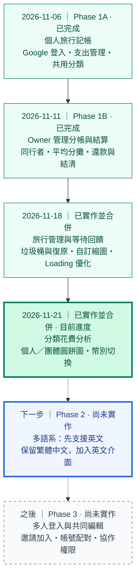

# 產品 Roadmap

朋友出遊的旅行記帳與分帳工具，從 owner 單人管理，逐步走向英文支援與多人共編。

更新：2026-11-23 · 已同步 `origin/main`（`99e029b`）。下圖日期為合併 main 的日期；未來階段尚未排定日期。

**接續順序：英文多語系 → 多人共編。** 目前仍由 owner 單獨操作；不同幣別獨立計算，不換匯。

驗收保留事項與規格連結

| 項目 | 紀錄與待辦 |
| --- | --- |
| 個人記帳 | [001 規格](../specs/plans/001-personal-travel-expenses/spec.md) |
| 分帳與結算 | [005 規格](../specs/plans/005-owner-managed-trip-splitting/spec.md)／[驗證紀錄](../specs/plans/005-owner-managed-trip-splitting/validation.md) |
| 旅行管理與等待回饋 | 已取得人眼驗收接受；真機／讀屏與原完整獨立 UI 審查依指示略過，baseline 回填與核對暫緩。[006 任務](../specs/plans/006-trip-management-and-loading/tasks.md)／[驗證紀錄](../specs/plans/006-trip-management-and-loading/validation.md) |
| 分類花費分析 | T132–T135 尚未完成：最新版本完整前端回歸／人工驗收、獨立 UI gate、baseline 回填與核對。[007 任務](../specs/plans/007-category-expense-charts/tasks.md)／[驗證摘要](../specs/plans/007-category-expense-charts/checks/verification-summary.md) |

「已實作並合併」不代表整個 plan 已完整驗收，也不代表線上已部署。

後續規劃邊界

- **英文多語系**：正式規劃時確認翻譯範圍、語言切換、預設語言、偏好保存及日期／數字／幣別格式；使用者輸入內容的翻譯另行確認。
- **多人共編**：英文支援之後，再確認邀請與加入、帳號與同行者配對、成員權限、操作追蹤及資料衝突規則。
- **未排程的擴展**：更多分攤方式、匯出、匯率換算及收據記錄，依使用回饋評估。

Roadmap 記錄方向與順序；詳細需求與驗收標準以各次 plan package 為準。

